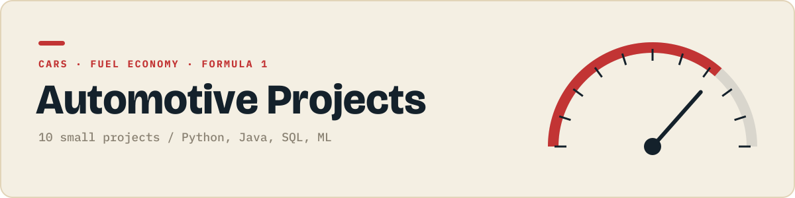

<p align="center"></p>

<p align="center">
  
  
</p>

Cars, fuel economy and Formula 1.

Each folder is one small, self contained project that does one thing. They get harder as the numbers go up: first scripts, then data and charts, then Java, SQL and APIs, then a first machine learning model.

## Projects

| # | Project | What it does | Language | Status |
|:-:|---|---|:-:|:-:|
| 01 | Trip fuel cost calculator | Works out what a road trip costs in fuel. |  | 🔜 |
| 02 | Car | Models vehicles with inheritance. |  | ⬜ |
| 03 | MPG to L/100km converter | Converts fuel economy units and charts them. |  | ⬜ |
| 04 | mtcars exploration | Explores the classic mtcars dataset. |  | ⬜ |
| 05 | EV vs petrol over the years | Charts the rise of EVs using EPA data. |  | ⬜ |
| 06 | Car loan vs lease | Compares the total cost of buying and leasing. |  | ⬜ |
| 07 | Parking lot simulator | Simulates cars queueing for parking spaces. |  | ⬜ |
| 08 | Used car price queries | Queries used car listings for average prices. |  | ⬜ |
| 09 | F1 lap time chart | Charts lap times from one Formula 1 race. |  | ⬜ |
| 10 | Used car price predictor | Predicts a car's price with regression. |  | ⬜ |

✅ done &nbsp; 🔜 up next &nbsp; ⬜ planned

## Running a project

```bash
git clone https://github.com/JilkaTeerth/automotive-projects.git
cd automotive-projects/01-...
```

Every folder has its own README with the exact commands. Python projects need `pip install -r requirements.txt`, Java projects compile with plain `javac`.

---

<sub>Part of a series of six project collections. See them all at [github.com/JilkaTeerth](https://github.com/JilkaTeerth).</sub>
